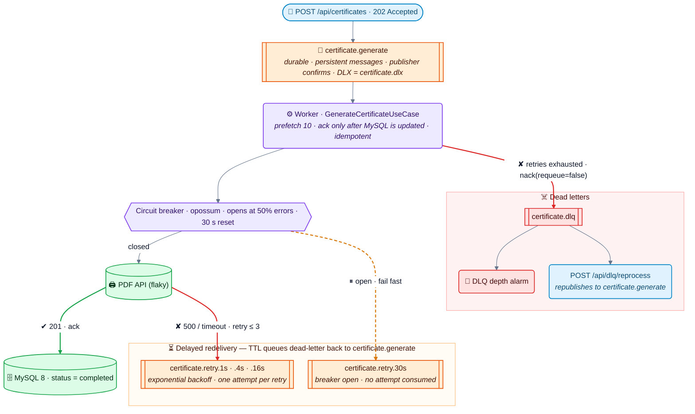
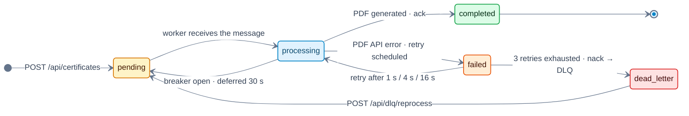
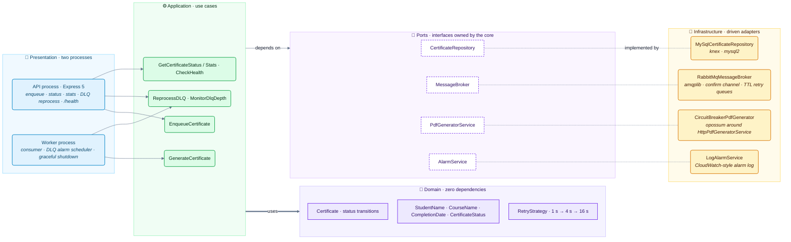

# 🛡️ resilient-pdf-worker

> A RabbitMQ worker that **never loses a message** when the external PDF API fails — retries with
> exponential backoff, a circuit breaker and a Dead Letter Queue, verified under chaos.

[](https://www.typescriptlang.org/)
[](https://nodejs.org/)
[](https://www.rabbitmq.com/)
[](https://www.mysql.com/)
[](https://docs.docker.com/compose/)
[](#-tests)
[](#-tests)
[](./LICENSE)

---

## 🎯 The Problem

An e-learning platform generates PDF certificates in a RabbitMQ worker. One day the external PDF
API starts answering **HTTP 500**. What happens to the messages?

| Strategy | Messages lost? | Failing API hammered? | Visible to operations? |
|---|---|---|---|
| `ack` immediately, log the error | ❌ yes | no | ⚠️ only in logs |
| `nack` **with** requeue | no | ❌ yes — infinite hot loop | ❌ no |
| **Retry with backoff + circuit breaker + `nack` without requeue → DLQ** | ✅ **no** | ✅ **no** | ✅ DLQ depth alarm |

## 💡 The Solution



- **No premature `ack`**: a message is acknowledged only after the certificate status is
  committed in MySQL; publishes use a confirm channel and persistent messages.
- **Retries without blocking the worker**: failed attempts go to TTL queues (1 s → 4 s → 16 s)
  that dead-letter the message back to `certificate.generate` — no `setTimeout` holding a channel.
- **Circuit breaker**: when the API fails ≥ 50% of the calls, opossum opens for 30 s; messages are
  parked for 30 s **without consuming a retry**, so an outage cannot exhaust everybody's attempts.
- **Dead Letter Queue**: after 3 retries the message is `nack`ed without requeue and routed by
  `certificate.dlx` to `certificate.dlq`; an alarm watches the DLQ depth and
  `POST /api/dlq/reprocess` republishes it once the API is back.
- **Idempotent**: a redelivered message for an already completed certificate is acknowledged
  without generating the PDF again.

### Certificate lifecycle



---

## 📊 Verified Under Chaos — `npm run bench:chaos`

Measured against the **real docker-compose stack** (API + worker + RabbitMQ 3 + MySQL 8 + the
flaky PDF API, 20–80 ms latency) on 2026-10-06 — nothing mocked. Each scenario waits until MySQL
and every queue have settled. Raw output: [`benchmarks/chaos-results.md`](benchmarks/chaos-results.md).

| Scenario | PDF API failure rate | Certificates | Completed | Dead-lettered | **Lost** | PDF API calls | Calls / cert. | Duplicate PDFs | Breaker | Time to settle |
|---|---|---:|---:|---:|---:|---:|---:|---:|---|---:|
| **Flaky API** | 30% | 300 | 298 | 2 | **0** | 423 (125 failed) | 1.41 | 0 | never opened | 24.2 s |
| **DLQ recovery** | 0% | 2 | 2 | 0 | **0** | 2 | 1.00 | 0 | — | 0.7 s |
| **Degraded API** | 70% for 180 s | 300 | 300 (78 during the incident) | 0 | **0** | 487 (187 failed) | 1.62 | 0 | opened 6× | 213.7 s |
| **Outage** | 100% for 45 s | 100 | 100 (0 during the outage) | 0 | **0** | 146 (46 failed) | 1.46 | 0 | opened 2× | 91.3 s |

**What the numbers show**

- **Zero messages lost, zero duplicate PDFs** across 702 certificates and four failure modes.
- **Retries absorb transient errors**: at 30% failures 298/300 certificates completed on their own.
  The 2 that failed all 4 attempts match the theory (0.3⁴ × 300 ≈ 2.4); both were recovered from
  the DLQ in under a second once the API was healthy.
- **The breaker shields a failing API**: during the 45 s outage only **46** failing calls reached
  the API for 100 messages — without a breaker every message would try 4 times (**400 calls**).
  Everything completed **46 s after the API came back**.
- **Degraded ≠ dead letter**: at 70% failures the breaker kept opening (6×), so throughput dropped
  to 78 certificates in 3 minutes — but messages were *parked*, not dead-lettered: 0 reached the
  DLQ and all 300 completed **34 s after recovery**. This is the trade-off of a 50% threshold:
  the API is protected, latency grows.

> [`benchmarks/BENCHMARK_REPORT.md`](benchmarks/BENCHMARK_REPORT.md) (`npm run bench`) holds
> in-process micro-benchmarks run with in-memory adapters (use-case overhead, breaker fail-fast,
> UUID generation); they are not end-to-end numbers.

---

## 🏗️ Architecture

**Clean Architecture + DDD + TypeScript (strict)** — the API (producer) and the worker (consumer)
are separate processes sharing the same core.



```
src/
├── domain/           # Certificate entity (status transitions), value objects, RetryStrategy, ports
├── application/      # Enqueue, Generate, ReprocessDLQ, MonitorDlqDepth, Status/Stats, Health
├── infrastructure/   # RabbitMQ topology + broker, MySQL repository, circuit-breaker PDF client, config, logging
└── presentation/     # Express API, worker process, CLI (migrate)
chaos/                # Flaky PDF API (failure rate & latency configurable at runtime)
benchmarks/           # chaos-verification.ts (real stack) · run-benchmark.ts (in-process)
```

### Key technical decisions

| Decision | Rationale | ADR |
|---|---|---|
| `nack` without requeue + DLQ | No hot retry loop; failed messages are kept and observable | [ADR-001](docs/adr/001-nack-without-requeue.md) |
| Circuit breaker (opossum) | Stop calling a dead API, fail fast, probe it again after 30 s | [ADR-002](docs/adr/002-circuit-breaker-pattern.md) |
| Exponential backoff via TTL queues | 1 s → 4 s → 16 s without holding the channel or the event loop | [ADR-003](docs/adr/003-retry-with-exponential-backoff.md) |
| Breaker-open messages are deferred, not retried | An outage must not burn every message's retry budget | [ADR-002](docs/adr/002-circuit-breaker-pattern.md) |
| One-shot `migrate` service in Compose | API and worker used to race on `knex_migrations` at boot | — |

---

## 🔌 API

| Method | Path | Description |
|---|---|---|
| `POST` | `/api/certificates` | `{ studentId, studentName, courseName, completionDate? }` → `202 { certificateId, status, statusUrl }` |
| `GET` | `/api/certificates/:id` | Status, attempts, last error, PDF URL |
| `GET` | `/api/certificates/stats` | Certificates per status (MySQL) + depth of the work, retry and dead-letter queues |
| `POST` | `/api/dlq/reprocess` | `{ limit? }` → moves DLQ messages back to `certificate.generate` |
| `GET` | `/health` | `503` when MySQL or RabbitMQ is down; `degraded` (still `200`) when only the PDF API is down — the API keeps accepting work |

Flaky PDF API (chaos server, port 4000): `POST /chaos/config { failureRate, minLatencyMs, maxLatencyMs }`,
`GET /chaos/stats`, `POST /chaos/reset`.

---

## 🚀 Quick Start

```bash
docker compose up -d --build        # MySQL, RabbitMQ, flaky PDF API (70% failures), migrate, api, worker
curl localhost:3000/health          # {"status":"ok","checks":{"database":"up","rabbitmq":"up","pdfApi":"up"}}

curl -X POST localhost:3000/api/certificates -H "Content-Type: application/json" \
  -d '{"studentId":"std-1","studentName":"Ada Lovelace","courseName":"Node.js Advanced"}'
curl localhost:3000/api/certificates/stats

npm install && npm run bench:chaos  # the four chaos scenarios above (≈ 6 min)
```

RabbitMQ management UI: <http://localhost:15672> (guest / guest). Configuration: [`.env.example`](.env.example).

---

## 🧪 Tests

```bash
npm test               # 31 suites, 285 tests
npm run test:coverage  # 97.6% statements · 89.1% branches · 94.9% functions · 97.5% lines
```

Unit tests cover the entity transitions, retry strategy, every use case (happy path, API failure,
breaker open, max retries, duplicate delivery), the RabbitMQ/MySQL adapters (with fakes), the
HTTP layer and graceful shutdown. Integration (Testcontainers) and e2e suites are not written yet;
end-to-end behaviour is verified against the real stack by `npm run bench:chaos`.

## 🛠️ Scripts

| Script | Description |
|---|---|
| `npm run dev:api` / `npm run dev:worker` / `npm run dev:chaos` | API, worker and flaky PDF API with hot reload |
| `npm run build` / `npm run start:api` / `npm run start:worker` | Production build and processes |
| `npm run migrate` / `npm run migrate:rollback` | Database migrations |
| `npm run bench:chaos` | End-to-end chaos verification → `benchmarks/chaos-results.md` |
| `npm run bench` | In-process micro-benchmarks → `benchmarks/BENCHMARK_REPORT.md` |
| `npm run chaos:demo` | Short interactive demo against a running stack |
| `npm run lint` / `typecheck` / `format:check` | Quality gates |

## 📚 Tech Stack

| Technology | Role |
|---|---|
| **TypeScript 5.9** (strict) · **Node.js 22+** | Language & runtime |
| **RabbitMQ 3** + **amqplib** | Durable queues, TTL retry queues, DLX/DLQ, publisher confirms |
| **opossum** | Circuit breaker |
| **MySQL 8** + **knex** / mysql2 | Certificate status tracking, migrations |
| **Express 5** | HTTP API + flaky PDF API |
| **zod** · **pino** | Input/config validation · structured logging |
| **Jest** | Unit tests |
| **Docker Compose** | Full local stack, one-shot migrations |

## 📄 License

[MIT](./LICENSE)
